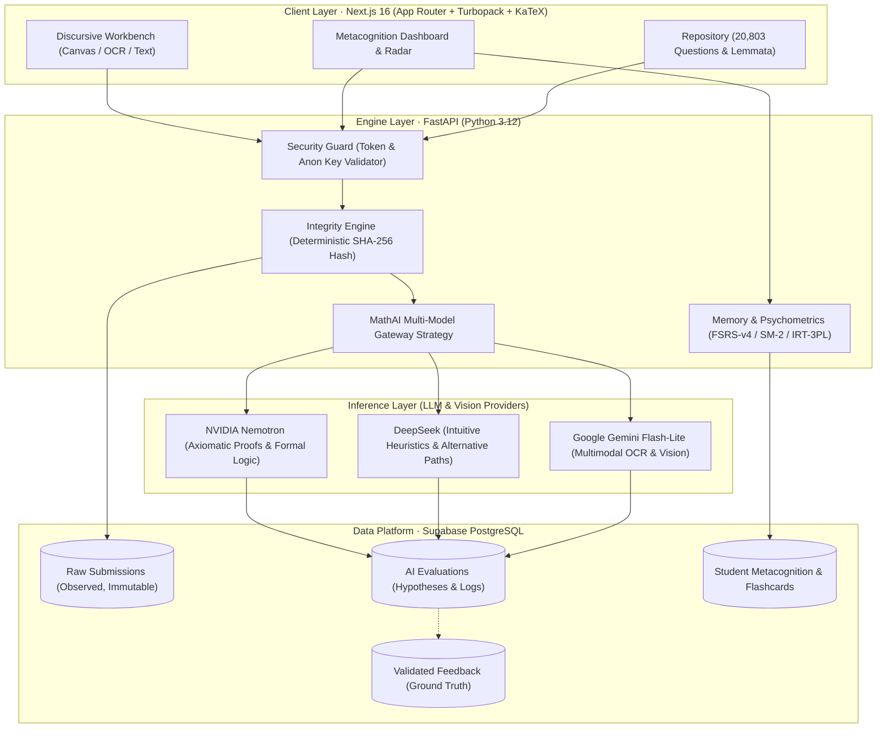

<div align="center">
  <h1>Lemmas 📐</h1>
  <p><strong>Adaptive mathematics learning platform powered by data, psychometrics, and multi-model AI.</strong></p>
  <p>An applied engineering project exploring Data Engineering, Applied Machine Learning, and Epistemic System Design.</p>
  <p><a href="./README.pt-BR.md">🇧🇷 Português (Brasil)</a> &nbsp;|&nbsp; <strong>🇺🇸 English</strong></p>
  <p><a href="https://lemmas-ochre.vercel.app/dashboard"><strong>🚀 Try Lemmas Live Demo</strong></a></p>
  <p>
    
    
    
    
    
    
    
  </p>
</div>

---

## 📌 Executive Summary

What happens when an adaptive learning platform treats the student's problem-solving process as **structured data** rather than merely logging binary correct/incorrect answers?

Two students can miss the same calculus problem for completely different reasons: one may suffer from an axiomatic misconception (e.g., misapplying the Chain Rule), while the other understands the concept perfectly but made an elementary arithmetic error. 

**Lemmas** was architected from first principles by a Mathematics undergraduate at **Universidade Federal Fluminense (UFF)**. It unites mathematical rigor, modern Data Engineering, and psychometric modeling to evaluate discursive mathematical proofs step-by-step.

```
┌─────────────────────────────────────────────────────────────────────────────┐
│                       CORE EPISTEMIC MANDATE                                │
│                                                                             │
│   RAW OBSERVED DATA        AI INTERPRETATION         VALIDATED GROUND TRUTH │
│  [Immutable SHA-256]   ≠   [Versioned Model]    ≠     [Human-in-the-Loop]   │
│   Student's verbatim        Hypothesis with            Verified label for   │
│    handwriting/text          prompt provenance          supervised training │
└─────────────────────────────────────────────────────────────────────────────┘
```

---

## 📸 Product Visual Showcase

| Discursive Workbench & KaTeX Rendering | Multi-Model Second Opinion |
| :---: | :---: |
|  |  |
| *Step-by-step proof workbench with canvas scratchpad, compass, and multimodal OCR.* | *Side-by-side comparative debate: Axiomatic Rigor (Nemotron) vs Heuristics.* |

| Metacognitive Dashboard & Mastery Radar | Audited Question & Lemma Repository (20,803 Items) |
| :---: | :---: |
|  |  |
| *Retention cycles, domain mastery metrics, and error pattern telemetry.* | *Classified Olympiad & military exam questions rendered in native KaTeX.* |

---

## 🏗️ System Architecture

The platform separates user interaction, API contracts, model routing, and persistent storage into isolated layers:



---

## 🔬 Mathematical & Psychometric Foundations

Lemmas approaches learning through formal mathematical modeling rather than opaque heuristic guessing, strictly distinguishing between **what runs in production today** and **exploratory research**:

### 1. Spaced Repetition in Production: SuperMemo-2 (SM-2)
In the current live deployment, retention schedules for questions and lemmata are actively computed and persisted using the deterministic **SuperMemo-2 (SM-2)** algorithm:
- Every evaluated submission updates the student's Ease Factor ($EF \in [1.3, 2.5]$) and interval $I(n)$:
  $$EF' = \max\left(1.3, \; EF + (0.1 - (5 - q) \cdot (0.08 + (5 - q) \cdot 0.02))\right)$$
  Where $q \in [0, 5]$ is the performance grade mapped from the four qualitative verdicts.
- Persistent state is written immediately to `public.revisao_espacada` on Supabase PostgreSQL.

### 2. Algorithmic Prototype: FSRS-v4 (Free Spaced Repetition Scheduler)
For flashcard and lemmata decay modeling, the backend provides an initial implementation inspired by the modern FSRS formulation:
$$R(t) = \left(1 + F \cdot \frac{t}{S}\right)^{-1}$$
- Memory stability ($S$) and difficulty ($D$) data contracts are implemented in `app/services/mathai/flashcards.py`.
- *Status:* Operational in prototype mode with heuristic constants; empirical parameter optimization via maximum likelihood estimation is planned once user interaction volume increases.

### 3. Scientific Research Target: Item Response Theory (IRT / TRI 3PL)
To evolve beyond ordinal difficulty tags (1 to 5) into continuous psychometrics, future offline data science experiments will calibrate items using the Three-Parameter Logistic Model:
$$P(\theta) = c + \frac{1 - c}{1 + e^{-a(\theta - b)}}$$
- $\theta$: Latent mathematical proficiency of the student.
- $a$: Item discrimination power.
- $b$: Item intrinsic difficulty parameter.
- $c$: Pseudo-guessing parameter for multiple-choice questions.
- *Status:* Formal research roadmap. No custom latent trait estimator is claimed as deployed today.

---

## 🛠️ Data Engineering & MLOps Highlights

- **Data Integrity & Traceability:** Every student submission computes a deterministic SHA-256 digest over the raw input (canvas strokes, transcribed text, or uploaded image bytes) before entering the inference pipeline.
- **Strict Data Contracts:** Clean Pydantic schemas (DTOs) enforce input/output contracts across all FastAPI routes.
- **Relational Integrity with Row Level Security (RLS):** 20 PostgreSQL tables hosted on Supabase enforce multi-tenant isolation so no student data can ever leak across sessions.
- **Multi-Model Strategy Pattern:** A dynamic routing gateway decouples application code from concrete AI providers:
  - **NVIDIA Nemotron 70B/120B:** Formal derivation and rigorous verification.
  - **Google Gemini Flash-Lite:** Low-latency (<600ms) OCR of handwritten student notebook pages.
  - **DeepSeek:** Conceptual suggestions and creative heuristic shortcuts.

---

## 💻 Tech Stack

| Domain | Technologies |
|---|---|
| **Frontend** | Next.js 16 (App Router), React 19, TypeScript, Tailwind CSS 4, KaTeX |
| **Backend** | Python 3.12, FastAPI, Pydantic V2, Uvicorn |
| **Database & Auth** | Supabase (PostgreSQL with RLS), deterministic SHA-256 hashing |
| **Applied AI & Vision** | Google Gemini (OCR), NVIDIA NIM / Nemotron, DeepSeek |
| **Psychometrics & Memory**| SM-2 Engine (Active in production), FSRS-v4 (Prototype), IRT 3PL (Research Roadmap) |
| **Testing & Quality** | pytest (Backend & Core architecture), Vitest (Frontend components) |

---

## 🚀 Running Locally

### Prerequisites
- Python 3.12+
- Node.js 20+
- A Supabase project (or local PostgreSQL)

### 1. Clone the repository
```bash
git clone https://github.com/StylishGH/LemmaS.git
cd LemmaS
```

### 2. Start Backend API
```bash
cd backend
python -m venv .venv

# Linux / macOS:
source .venv/bin/activate
# Windows:
.venv\Scripts\Activate.ps1

pip install -r requirements.txt
cp ../.env.example .env
uvicorn app.main:app --reload --port 8000
```
*API documentation will be available at `http://localhost:8000/docs`.*

### 3. Start Frontend
```bash
cd ../frontend
npm install
npm run dev
```
*Open `http://localhost:3000` in your browser.*

---

## 🎯 Current Status & Deliberate Engineering Roadmap

- [x] **Monorepo Architecture:** Next.js 16 frontend + FastAPI backend.
- [x] **Epistemic Data Pipeline:** SHA-256 hashing and raw submission isolation.
- [x] **Discursive Workbench & Multimodal OCR:** KaTeX parsing of handwritten drafts.
- [x] **Audited Question Bank:** 20,803 classified math problems.
- [x] **Multi-Model Gateway:** Rerouting between Nemotron, Gemini, and DeepSeek.
- [ ] **Full Database Migration:** Replacing remaining prototype in-memory stores with durable PostgreSQL tables.
- [ ] **Empirical Calibration:** Fine-tuning FSRS parameters with real student interaction logs.
- [ ] **Model Evals Harness:** Systematic latency, cost, and hallucination benchmark suite across mathematical task types.

---

## 👨‍💻 About the Author

**Guilherme Henrique Mendes**  
*Undergraduate in Mathematics at Universidade Federal Fluminense (UFF)*  
Passionate about Data Science, Machine Learning, Psychometrics, and Software Engineering.

- 💼 **LinkedIn:** [linkedin.com/in/ghmendes02](https://linkedin.com/in/ghmendes02)
- 🐙 **GitHub:** [github.com/StylishGH](https://github.com/StylishGH)
- 📧 **Email:** [ghmendes@id.uff.br](mailto:ghmendes@id.uff.br)

---

*Lemmas is the learning platform. MathAI is the specialized intelligence layer powering it.*
