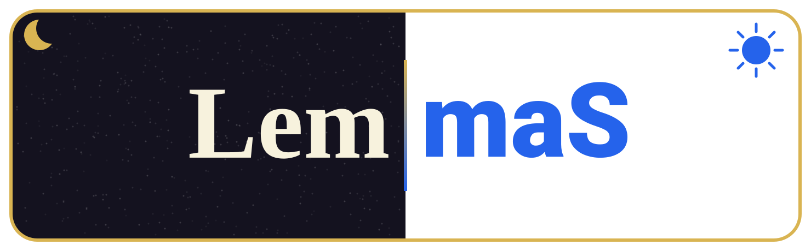
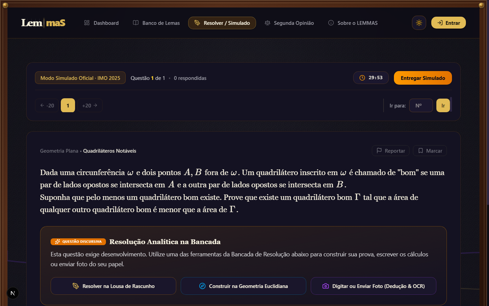
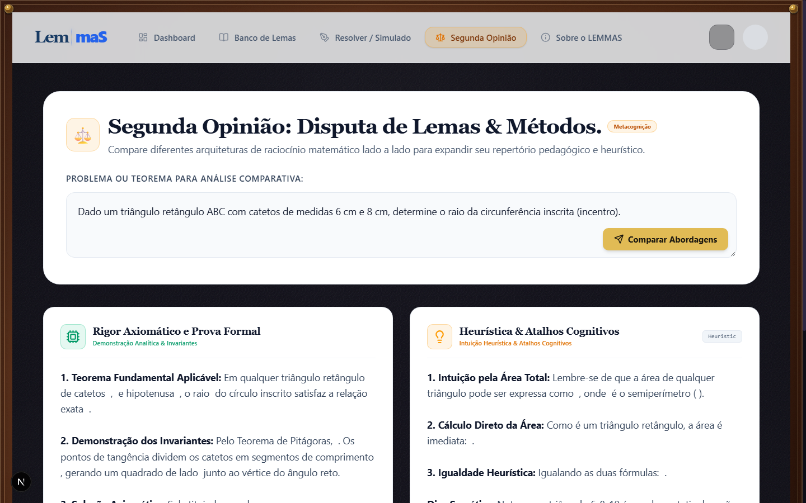
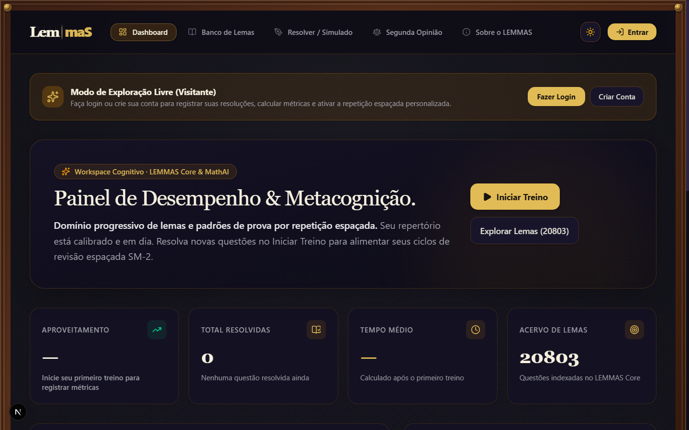
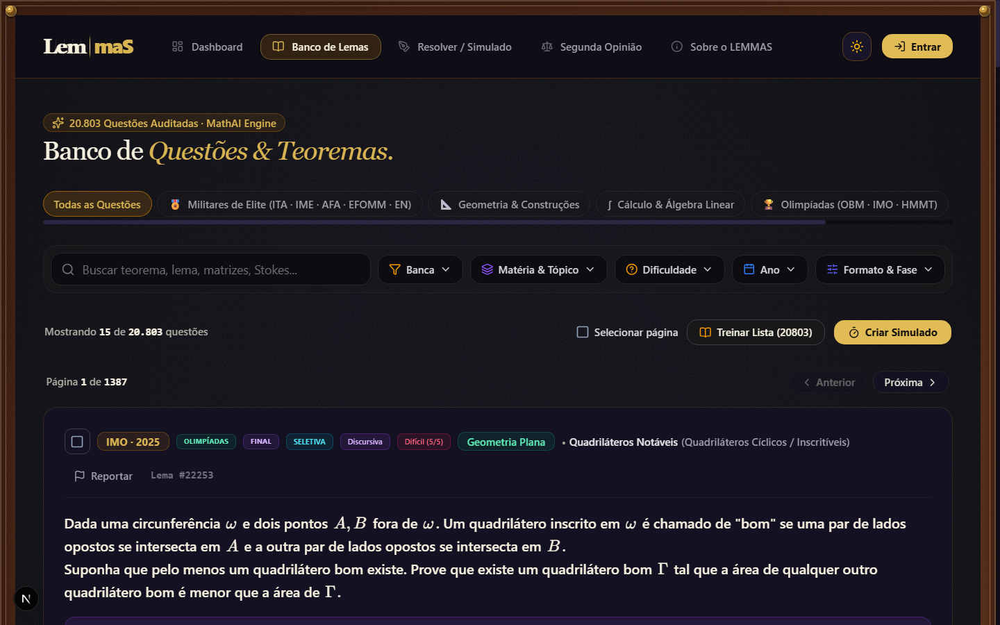

<div align="center">
  
  <p><strong>Plataforma de aprendizagem matemática adaptativa guiada por dados, psicometria e IA multi-modelo.</strong></p>
  <p>Um projeto de engenharia aplicada na interseção entre Engenharia de Dados, Ciência de Dados / Machine Learning e Design Epistêmico.</p>
  <p><strong>🇧🇷 Português (Brasil)</strong> &nbsp;|&nbsp; <a href="./README.md">🇺🇸 English</a></p>
  <p><a href="https://lemmas-ochre.vercel.app/dashboard"><strong>🚀 Acesse a Demonstração ao Vivo do Lemmas</strong></a></p>
  <p>
    
    
    
    
    
    
    
  </p>
</div>

---

## 📌 Sumário Executivo

O que acontece quando uma plataforma de aprendizagem trata o processo de resolução do estudante como **dados estruturados**, em vez de apenas registrar respostas binárias de certo ou errado?

Dois estudantes podem errar a mesma questão de cálculo por razões fundamentalmente distintas: um pode apresentar um equívoco axiomático (ex: aplicar incorretamente a Regra da Cadeia), enquanto o outro domina o conceito perfeitamente, mas cometeu uma distração aritmética elementar.

O **Lemmas** foi projetado por primeiros princípios por um graduando em Matemática pela **Universidade Federal Fluminense (UFF)**. Ele une rigor matemático, Engenharia de Dados moderna e modelagem psicométrica para avaliar demonstrações e resoluções discursivas passo a passo.

<table align="center">
  <tr>
    <td colspan="5" align="center"><strong>MANDAMENTO EPISTÊMICO FUNDAMENTAL</strong></td>
  </tr>
  <tr>
    <td align="center">
      <strong>DADO OBSERVADO</strong><br />
      [Hash SHA-256 Imutável]<br />
      Manuscrito/texto<br />
      fiel do aluno
    </td>
    <td align="center">≠</td>
    <td align="center">
      <strong>INTERPRETAÇÃO DA IA</strong><br />
      [Modelo Versionado]<br />
      Hipótese com prompt e<br />
      grau de confiança
    </td>
    <td align="center">≠</td>
    <td align="center">
      <strong>DADO VALIDADO</strong><br />
      [Human-in-the-Loop]<br />
      Rótulo conferido<br />
      para treino de ML
    </td>
  </tr>
</table>

---

## 📸 Demonstração Visual do Produto

<table align="center">
  <tr>
    <td align="center" width="50%">
      <strong>Bancada Discursiva &amp; Renderização KaTeX</strong><br />
      <br />
      <em>Bancada de resolução analítica com lousa de rascunho, compasso euclidiano e OCR multimodal.</em>
    </td>
    <td align="center" width="50%">
      <strong>Segunda Opinião Multi-Modelo</strong><br />
      <br />
      <em>Debate comparativo: Rigor Axiomático (Nemotron) vs Heurísticas e Atalhos Cognitivos.</em>
    </td>
  </tr>
  <tr>
    <td align="center" width="50%">
      <strong>Painel de Metacognição &amp; Radar de Domínio</strong><br />
      <br />
      <em>Ciclos de repetição espaçada, telemetria de erros e radar de domínio por matéria.</em>
    </td>
    <td align="center" width="50%">
      <strong>Acervo de 20.803 Questões &amp; Teoremas</strong><br />
      <br />
      <em>Questões auditadas de olimpíadas e vestibulares militares renderizadas em KaTeX nativo.</em>
    </td>
  </tr>
</table>

---

## 🏗️ Arquitetura do Sistema

A plataforma desacopla a interação do usuário, contratos de API, roteamento de modelos e persistência relacional em camadas bem definidas:

<table align="center">
  <tr>
    <td align="center">
      <strong>Camada Cliente · Next.js 16 (App Router + Turbopack + KaTeX)</strong><br />
      Bancada Discursiva (Lousa / OCR / Texto) · Painel de Metacognição &amp; Radar · Acervo (20.803 Questões &amp; Lemas)
    </td>
  </tr>
  <tr><td align="center">⬇</td></tr>
  <tr>
    <td align="center">
      <strong>Motor Backend · FastAPI (Python 3.12)</strong><br />
      Guarda de Segurança (Validador de Token e Anon Key) · Motor de Integridade (Hash SHA-256 Determinístico) · Gateway Multi-Modelo MathAI · Psicometria &amp; Memória (FSRS-v4 / SM-2 / TRI-3PL)
    </td>
  </tr>
  <tr><td align="center">⬇</td></tr>
  <tr>
    <td align="center">
      <strong>Camada de Inferência (Provedores LLM &amp; Visão)</strong><br />
      NVIDIA Nemotron (Provas Axiomáticas &amp; Lógica Formal) · DeepSeek (Heurísticas &amp; Caminhos Alternativos) · Google Gemini Flash-Lite (OCR Multimodal &amp; Visão)
    </td>
  </tr>
  <tr><td align="center">⬇</td></tr>
  <tr>
    <td align="center">
      <strong>Plataforma de Dados · Supabase PostgreSQL</strong><br />
      Tentativas Brutas (Dado Observado Imutável) · Avaliações da IA (Hipóteses &amp; Logs) · Feedback Humano Validado (Ground Truth) · Metacognição &amp; Flashcards
    </td>
  </tr>
</table>

---

## 🔬 Fundamentação Matemática & Modelagem Psicométrica

O Lemmas aborda a aprendizagem através de modelagem matemática formal em vez de heurísticas opacas, separando de forma estrita **o que roda em produção hoje** da **pesquisa exploratória**:

### 1. Repetição Espaçada em Produção: SuperMemo-2 (SM-2)
No deploy em produção, os ciclos de retenção de questões e lemas são calculados e persistidos ativamente através do algoritmo determinístico **SuperMemo-2 (SM-2)**:
- Cada submissão avaliada recalcula o Fator de Facilidade ($EF \in [1.3, 2.5]$) e o intervalo em dias $I(n)$:
  $$EF' = \max\left(1.3, \; EF + (0.1 - (5 - q) \cdot (0.08 + (5 - q) \cdot 0.02))\right)$$
  Onde $q \in [0, 5]$ é a nota qualitativa mapeada a partir dos 4 vereditos cognitivos da plataforma.
- O estado de retenção é gravado imediatamente na tabela `public.revisao_espacada` do Supabase PostgreSQL.

### 2. Protótipo Algorítmico: FSRS-v4 (Free Spaced Repetition Scheduler)
Para a modelagem da curva de esquecimento em flashcards e lemas, o backend possui uma implementação inicial inspirada na formulação moderna do FSRS:
$$R(t) = \left(1 + F \cdot \frac{t}{S}\right)^{-1}$$
- Os contratos de estabilidade mnemônica ($S$) e dificuldade intrínseca ($D$) estão definidos em `app/services/mathai/flashcards.py`.
- *Status:* Operacional em modo protótipo com constantes aproximadas; a calibração empírica dos hiperparâmetros via estimativa de máxima verossimilhança está planejada para a Fase 2 conforme o volume de interações crescer.

### 3. Alvo de Pesquisa Científica: Teoria de Resposta ao Item (TRI 3PL)
Para evoluir da dificuldade ordinal (1 a 5) das bancas para uma métrica psicométrica contínua, os experimentos futuros de ciência de dados calibrarão as questões via Modelo Logístico de Três Parâmetros:
$$P(\theta) = c + \frac{1 - c}{1 + e^{-a(\theta - b)}}$$
- $\theta$: Proficiência matemática latente do estudante.
- $a$: Parâmetro de discriminação do item.
- $b$: Parâmetro de dificuldade intrínseca do teorema/exercício.
- $c$: Probabilidade de acerto casual (chute em itens objetivos).
- *Status:* Roadmap de pesquisa formal. Nenhum estimador de traço latente personalizado é reivindicado como operando em produção hoje.

---

## 🛠️ Destaques de Engenharia de Dados & MLOps

- **Integridade e Rastreabilidade de Dados:** Cada tentativa submetida pelo aluno gera um hash determinístico SHA-256 dos dados brutos (traços da lousa, texto digitado ou bytes da imagem) antes de qualquer chamada a modelos de IA.
- **Contratos Estritos de Dados:** Schemas Pydantic (DTOs) garantem validação e serialização de tipos em todas as rotas da API FastAPI.
- **Isolamento Relacional com Row Level Security (RLS):** 20 tabelas PostgreSQL hospedadas no Supabase aplicam políticas rigorosas de isolamento multi-tenant.
- **Padrão Strategy no Roteamento Multi-Modelo:** Desacoplamento da camada de inferência:
  - **NVIDIA Nemotron 70B/120B:** Demonstrações formais e checagem axiomática estrita.
  - **Google Gemini Flash-Lite:** OCR de rascunhos manuscritos em caderno com latência reduzida (<600ms).
  - **DeepSeek:** Sugestões intuitivas, contra-exemplos e atalhos cognitivos.

---

## 💻 Tecnologias Empregadas

| Domínio | Tecnologias |
|---|---|
| **Frontend** | Next.js 16 (App Router), React 19, TypeScript, Tailwind CSS 4, KaTeX |
| **Backend** | Python 3.12, FastAPI, Pydantic V2, Uvicorn |
| **Banco de Dados & Auth** | Supabase (PostgreSQL com RLS), Hashes SHA-256 determinísticos |
| **IA Aplicada & Visão** | Google Gemini (OCR), NVIDIA NIM / Nemotron, DeepSeek |
| **Psicometria & Repetição** | Motor SM-2 (Ativo em produção), FSRS-v4 (Protótipo), TRI 3PL (Roadmap de Pesquisa) |
| **Testes & Qualidade** | pytest (Backend & Testes de Arquitetura), Vitest (Componentes de UI) |

---

## 🚀 Como Executar Localmente

### Pré-requisitos
- Python 3.12+
- Node.js 20+
- Um projeto Supabase configurado (ou PostgreSQL local)

### 1. Clonar o repositório
```bash
git clone https://github.com/StylishGH/LemmaS.git
cd LemmaS
```

### 2. Configurar e rodar o Backend API
```bash
cd backend
python -m venv .venv

# Linux / macOS:
source .venv/bin/activate
# Windows PowerShell:
.venv\Scripts\Activate.ps1

pip install -r requirements.txt
cp ../.env.example .env
uvicorn app.main:app --reload --port 8000
```
*A documentação interativa da API fica disponível em `http://localhost:8000/docs`.*

### 3. Rodar o Frontend
```bash
cd ../frontend
npm install
npm run dev
```
*Acesse `http://localhost:3000` no seu navegador.*

---

## 🎯 Status Atual & Roadmap de Engenharia

- [x] **Arquitetura Monorepo:** Frontend Next.js 16 + Backend FastAPI.
- [x] **Pipeline Epistêmico de Dados:** Hashing SHA-256 e segregação estrita de dados submetidos.
- [x] **Bancada Discursiva & OCR Multimodal:** Parser KaTeX para rascunhos manuscritos.
- [x] **Acervo de 20.803 Questões:** Base de problemas matemáticos auditados e catalogados.
- [x] **Gateway Multi-Modelo:** Roteamento entre Nemotron, Gemini e DeepSeek.
- [ ] **Migração de Persistência Completa:** Substituição gradual dos handlers em memória por tabelas duráveis no PostgreSQL.
- [ ] **Calibração Empírica:** Ajuste dos hiperparâmetros do FSRS com base em logs reais de interação.
- [ ] **Harness de Avaliação Contínua (Evals):** Suite de benchmarks de latência, custo e concordância de diagnósticos entre modelos de IA.

---

## 👨‍💻 Sobre o Autor

**Guilherme Henrique Mendes**  
*Graduando em Matemática pela Universidade Federal Fluminense (UFF)*  
Focado em Ciência de Dados, Machine Learning, Psicometria e Engenharia de Software.

- 💼 **LinkedIn:** [linkedin.com/in/ghmendes02](https://linkedin.com/in/ghmendes02)
- 🐙 **GitHub:** [github.com/StylishGH](https://github.com/StylishGH)
- 📧 **E-mail:** [ghmendes@id.uff.br](mailto:ghmendes@id.uff.br)

---

*Lemmas é a plataforma de aprendizagem. MathAI é a camada de inteligência especializada que a potencializa.*
