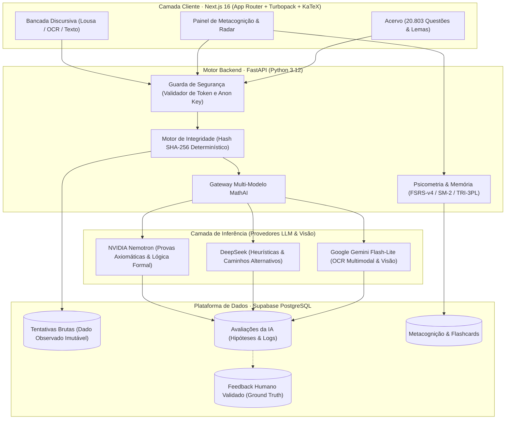

<div align="center">
  <h1>Lemmas 📐</h1>
  <p><strong>Plataforma de aprendizagem matemática adaptativa guiada por dados, psicometria e IA multi-modelo.</strong></p>
  <p>Um projeto de engenharia aplicada na interseção entre Engenharia de Dados, Ciência de Dados / Machine Learning e Design Epistêmico.</p>
  <p><strong>🇧🇷 Português (Brasil)</strong> &nbsp;|&nbsp; <a href="./README.md">🇺🇸 English</a></p>
  <p><a href="https://lemmas-ochre.vercel.app/dashboard"><strong>🚀 Acesse a Demonstração ao Vivo do Lemmas</strong></a></p>
  <p>
    
    
    
    
    
    
    
  </p>
</div>

---

## 📌 Sumário Executivo

O que acontece quando uma plataforma de aprendizagem trata o processo de resolução do estudante como **dados estruturados**, em vez de apenas registrar respostas binárias de certo ou errado?

Dois estudantes podem errar a mesma questão de cálculo por razões fundamentalmente distintas: um pode apresentar um equívoco axiomático (ex: aplicar incorretamente a Regra da Cadeia), enquanto o outro domina o conceito perfeitamente, mas cometeu uma distração aritmética elementar.

O **Lemmas** foi projetado por primeiros princípios por um graduando em Matemática pela **Universidade Federal Fluminense (UFF)**. Ele une rigor matemático, Engenharia de Dados moderna e modelagem psicométrica para avaliar demonstrações e resoluções discursivas passo a passo.

```
┌─────────────────────────────────────────────────────────────────────────────┐
│                       MANDAMENTO EPISTÊMICO FUNDAMENTAL                     │
│                                                                             │
│     DADO OBSERVADO            INTERPRETAÇÃO DA IA          DADO VALIDADO    │
│  [Hash SHA-256 Imutável]  ≠   [Modelo Versionado]   ≠   [Human-in-the-Loop] │
│     Manuscrito/texto           Hipótese com prompt e     Rótulo conferido   │
│      fiel do aluno             grau de confiança         para treino de ML  │
└─────────────────────────────────────────────────────────────────────────────┘
```

---

## 📸 Demonstração Visual do Produto

| Bancada Discursiva & Renderização KaTeX | Segunda Opinião Multi-Modelo |
| :---: | :---: |
|  |  |
| *Bancada de resolução analítica com lousa de rascunho, compasso euclidiano e OCR multimodal.* | *Debate comparativo: Rigor Axiomático (Nemotron) vs Heurísticas e Atalhos Cognitivos.* |

| Painel de Metacognição & Radar de Domínio | Acervo de 20.803 Questões & Teoremas |
| :---: | :---: |
|  |  |
| *Ciclos de repetição espaçada, telemetria de erros e radar de domínio por matéria.* | *Questões auditadas de olimpíadas e vestibulares militares renderizadas em KaTeX nativo.* |

---

## 🏗️ Arquitetura do Sistema

A plataforma desacopla a interação do usuário, contratos de API, roteamento de modelos e persistência relacional em camadas bem definidas:



---

## 🔬 Modelagem Matemática e Psicométrica

O Lemmas evita suposições de "caixa preta" através de modelos matemáticos estabelecidos na literatura científica para retenção e calibração de proficiência:

### 1. Modelagem de Retenção de Memória: FSRS-v4 & SM-2
Para calcular o momento ideal de revisão de cada lema e teorema matemático, o motor aplica a fórmula de recuperabilidade inspirada no algoritmo FSRS-v4:
$$R(t) = \left(1 + F \cdot \frac{t}{S}\right)^{-1}$$
Onde:
- $R(t)$ é a probabilidade estimada de retenção na memória após $t$ dias.
- $S$ é a estabilidade mnemônica (tempo até a recuperabilidade cair para 90%).
- $F$ é o fator calibrado conforme o nível de dificuldade atribuído pelo estudante ($D \in [1, 10]$).

### 2. Teoria de Resposta ao Item (TRI 3PL)
A calibração do nível de proficiência e das questões utiliza o modelo logístico de três parâmetros:
$$P(\theta) = c + \frac{1 - c}{1 + e^{-a(\theta - b)}}$$
- $\theta$: Proficiência latente do aluno em determinada área (ex: Geometria, Análise).
- $a$: Parâmetro de discriminação da questão.
- $b$: Dificuldade intrínseca do teorema/exercício.
- $c$: Probabilidade de acerto casual (chute em itens objetivos).

---

## 🛠️ Destaques de Engenharia de Dados & MLOps

- **Integridade e Rastreabilidade de Dados:** Cada tentativa submetida pelo aluno gera um hash determinístico SHA-256 dos dados brutos (traços da lousa, texto digitado ou bytes da imagem) antes de qualquer chamada a modelos de IA.
- **Contratos Estritos de Dados:** Schemas Pydantic (DTOs) garantem validação e serialização de tipos em todas as rotas da API FastAPI.
- **Isolamento Relacional com Row Level Security (RLS):** 20 tabelas PostgreSQL hospedadas no Supabase aplicam políticas rigorosas de isolamento multi-tenant.
- **Padrão Strategy no Roteamento Multi-Modelo:** Desacoplamento da camada de inferência:
  - **NVIDIA Nemotron 70B/120B:** Demonstrações formais e checagem axiomática estrita.
  - **Google Gemini Flash-Lite:** OCR de rascunhos manuscritos em caderno com latência reduzida (<600ms).
  - **DeepSeek:** Sugestões intuitivas, contra-exemplos e atalhos cognitivos.

---

## 💻 Tecnologias Empregadas

| Domínio | Tecnologias |
|---|---|
| **Frontend** | Next.js 16 (App Router), React 19, TypeScript, Tailwind CSS 4, KaTeX |
| **Backend** | Python 3.12, FastAPI, Pydantic V2, Uvicorn |
| **Banco de Dados & Auth** | Supabase (PostgreSQL com RLS), Hashes SHA-256 determinísticos |
| **IA Aplicada & Visão** | Google Gemini (OCR), NVIDIA NIM / Nemotron, DeepSeek |
| **Psicometria & Repetição** | Repetição Espaçada FSRS-v4, Motor SM-2, Teoria de Resposta ao Item (TRI 3PL) |
| **Testes & Qualidade** | pytest (Backend & Testes de Arquitetura), Vitest (Componentes de UI) |

---

## 🚀 Como Executar Localmente

### Pré-requisitos
- Python 3.12+
- Node.js 20+
- Um projeto Supabase configurado (ou PostgreSQL local)

### 1. Clonar o repositório
```bash
git clone https://github.com/StylishGH/LemmaS.git
cd LemmaS
```

### 2. Configurar e rodar o Backend API
```bash
cd backend
python -m venv .venv

# Linux / macOS:
source .venv/bin/activate
# Windows PowerShell:
.venv\Scripts\Activate.ps1

pip install -r requirements.txt
cp ../.env.example .env
uvicorn app.main:app --reload --port 8000
```
*A documentação interativa da API fica disponível em `http://localhost:8000/docs`.*

### 3. Rodar o Frontend
```bash
cd ../frontend
npm install
npm run dev
```
*Acesse `http://localhost:3000` no seu navegador.*

---

## 🎯 Status Atual & Roadmap de Engenharia

- [x] **Arquitetura Monorepo:** Frontend Next.js 16 + Backend FastAPI.
- [x] **Pipeline Epistêmico de Dados:** Hashing SHA-256 e segregação estrita de dados submetidos.
- [x] **Bancada Discursiva & OCR Multimodal:** Parser KaTeX para rascunhos manuscritos.
- [x] **Acervo de 20.803 Questões:** Base de problemas matemáticos auditados e catalogados.
- [x] **Gateway Multi-Modelo:** Roteamento entre Nemotron, Gemini e DeepSeek.
- [ ] **Migração de Persistência Completa:** Substituição gradual dos handlers em memória por tabelas duráveis no PostgreSQL.
- [ ] **Calibração Empírica:** Ajuste dos hiperparâmetros do FSRS com base em logs reais de interação.
- [ ] **Harness de Avaliação Contínua (Evals):** Suite de benchmarks de latência, custo e concordância de diagnósticos entre modelos de IA.

---

## 👨‍💻 Sobre o Autor

**Guilherme Henrique Mendes**  
*Graduando em Matemática pela Universidade Federal Fluminense (UFF)*  
Focado em Ciência de Dados, Machine Learning, Psicometria e Engenharia de Software.

- 💼 **LinkedIn:** [linkedin.com/in/ghmendes02](https://linkedin.com/in/ghmendes02)
- 🐙 **GitHub:** [github.com/StylishGH](https://github.com/StylishGH)
- 📧 **E-mail:** [ghmendes@id.uff.br](mailto:ghmendes@id.uff.br)

---

*Lemmas é a plataforma de aprendizagem. MathAI é a camada de inteligência especializada que a potencializa.*
