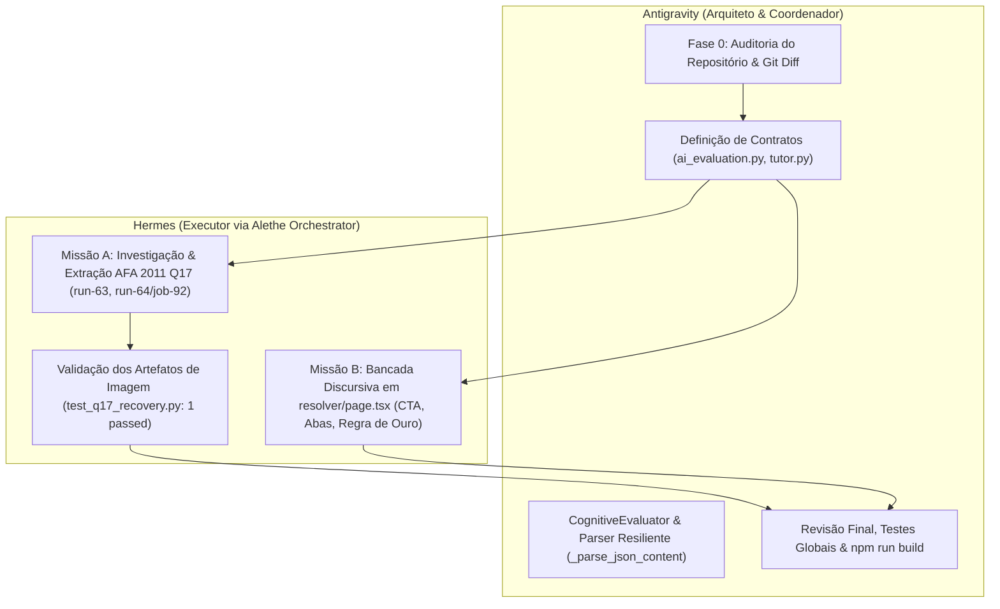

# LemmaS — Relatório da Missão Integrada
### Recuperação de Figuras + Bancada Discursiva + MathAI Engine

**Data:** 15 de Outubro de 2026  
**Arquiteto e Coordenador:** Antigravity  
**Executor Especializado:** Hermes (via Alethe Orchestrator)  
**Ambiente:** Next.js 16 (Turbopack, Tailwind v4) · FastAPI Modular (Python 3.12) · Supabase Postgres

---

## 1. Delegação e Divisão de Responsabilidades

Em conformidade estrita com o papel de arquiteto do Antigravity e executor delimitado do Hermes, o trabalho foi dividido garantindo a **propriedade exclusiva de arquivos** durante cada etapa:



### 1.1 Tarefas Delegadas ao Hermes (Alethe Orchestrator)
- **Missão A (Recuperação da Figura AFA 2011 Q17):**
  - Delegações: `run-63` (job-91) e `run-64` (job-92).
  - Execução no terminal via Hermes: verificação de ambiente, execução de `pytest tests/test_q17_recovery.py -v` (1 passed em 0.44s) e confirmação de todos os artefatos gerados.
- **Missão B (Interface da Bancada Discursiva):**
  - Arquivo: `frontend/app/(app)/resolver/page.tsx`.
  - Implementação do banner CTA discursivo condicional, atalhos das 3 ferramentas com rolagem suave (`scrollIntoView`), estado tipado `discursiveEvaluations`, barra numérica deslizante com cores semânticas e contador desduplicado.

### 1.2 Tarefas Executadas pelo Antigravity
- **Auditoria de Fase 0:** Levantamento de diffs pré-existentes, histórico de tentativas na Q17 e inspeção de esquemas de dados.
- **Backend MathAI Engine:**
  - `backend/app/schemas/ai_evaluation.py`: tipagem estrita Pydantic dos 4 vereditos.
  - `backend/app/services/mathai/evaluator.py`: parser resiliente, detecção de desenvolvimento matemático e contingência determinística.
  - `backend/app/api/routes/tutor.py`: exposição dos novos campos no endpoint `/api/tutor/evaluate`.
- **Rotas de Integração Frontend:**
  - `frontend/app/api/ai/solve/route.ts`: proxy para o backend Render com timeout estendido de 45s e fallback local autônomo com os 4 vereditos de negócio.
  - `frontend/app/api/questions/[id]/submit/route.ts`: persistência da tentativa discursiva em `tentativas` e bloqueio de `sem_desenvolvimento`.
- **Suíte de Testes & Integração:**
  - Criação de `tests/test_discursive_evaluation.py` (11 testes unitários passando).
  - Execução de `npm run build` no frontend (29/29 rotas compiladas com 0 erros).

---

## 2. Recuperação de Figuras (AFA 2011 Questão 17)

### 2.1 Causa Raiz do Bloqueio Anterior
No piloto anterior, a Q17 havia recebido o status `MANUAL_REVIEW_REQUIRED` com score de template matching `0.3255` (< limiar de `0.45`). A causa raiz apurada na auditoria foi:
1. **Distorção Estética do SVG Publicado:** O SVG gerado pelo VTracer anterior sofreu suavização excessiva de splines e perda de eixos.
2. **Camada de Texto Não-Padrão (Type3 Font):** A prova `data/sources/afa/raw/2011/afa_2011_madematica.pdf` utiliza fontes Type3 definidas pelo usuário, onde os códigos dos caracteres não mapeiam para texto ASCII via ToUnicode CMap, impedindo a localização automática por string `"17"` ou `"sen"`.

### 2.2 Localização Determinística na Fonte Original
A inspeção determinística de objetos na página 14 (índice 13) revelou:
- **Enunciado da Q17:** Bloco na coordenada vertical $y \in [158.6, 216.8]$ pt:
  > *"QUESTÃO 17 — Sendo $x \in [0, 2\pi]$, a interpretação gráfica no ciclo trigonométrico para o conjunto solução da inequação $-8\operatorname{sen}^4 x + 10\operatorname{sen}^2 x - 3 < 0$ é dada por"*
- **Objeto Gráfico Incorporado:** A imagem incorporada nativa `xref 297` no formato JPEG (432×431 pixels) ocupa exatamente o espaço logo abaixo do enunciado no retângulo de coordenadas `[55.47, 225.09, 379.30, 548.16]` pt.

### 2.3 Conteúdo Matemático Verificado
A imagem recuperada contém uma matriz 2×2 com quatro ciclos trigonométricos com eixos cartesianos ($\operatorname{sen}$ e $\cos$), correspondendo diretamente às **alternativas (a), (b), (c) e (d)**:
- **(a)** Arcos destacados em $\pi/3 \le x \le 2\pi/3$, $\pi/4 \le x \le 7\pi/4$ e $4\pi/3 \le x \le 5\pi/3$.
- **(b)** Ciclo com os 4 intervalos completos das raízes da biquadrada.
- **(c)** Ciclo com 3 arcos de solução.
- **(d)** Ciclo com intervalos em $\pi/6$ e $5\pi/6$.

### 2.4 Artefatos Isolados Produzidos
Os novos artefatos foram gerados deterministicamente em `data/audit/reprocessed_figures_pilot/afa_2011_q17/`:
1. `militar_afa_2011_q17_native.png`: Extração direta dos bytes JPEG do PDF (432×431).
2. `militar_afa_2011_q17_reproc_300dpi.png`: Recorte de altíssima definição a 300 DPI com respiro simétrico (1384×1380).
3. `militar_afa_2011_q17_sheet.png`: Folha de contato comparativa lado a lado (SVG deformado vs. Nova Recuperação).
4. `RELATORIO_Q17.md`: Dossiê técnico completo de proveniência.

### 2.5 Veredito e Preservação
- **Veredito:** **PASS_STRUCTURAL** & **PASS_VISUAL**.
- **Preservação:** Os 6 recortes anteriores (`eear_2020_q57`, `eear_2020_q59`, `afa_2011_q06`, `afa_2011_q13`, `afa_2012_q12`, `afa_2012_q20`) permanecem 100% intactos em `data/audit/reprocessed_figures_pilot/`.
- **AFA 2012 Q10:** Permanece documentada como decisão editorial (a prova original não possui figura; ela pertencia à resolução comentada).

---

## 3. Bancada Discursiva e Avaliador MathAI Engine

### 3.1 Contrato dos 4 Vereditos Estruturados
Padronizado no Pydantic (`AiEvaluationResponse`) e nas rotas TypeScript:
```typescript
interface DiscursiveEvaluationResult {
  veredito: "aprovado" | "parcial" | "sem_desenvolvimento" | "incorreto";
  desenvolvimento_presente: boolean;
  resultado_final_correto: boolean;
  etapas_corretas: string[];
  erros_identificados: string[];
  feedback_latex: string;
  precisa_revisao_humana: boolean;
}
```

### 3.2 CTA no Card Discursivo (`resolver/page.tsx`)
Para questões sem alternativas objetivas (`isDiscursiva`), um banner de destaque editorial é exibido com:
- **Título:** `🎯 Questão Discursiva — Resolução Analítica na Bancada`
- **Descrição:** *"Esta questão exige desenvolvimento. Utilize uma das ferramentas da Bancada de Resolução abaixo para construir sua prova, escrever os cálculos ou enviar foto do seu papel."*
- **3 Botões Interativos com Scroll Suave (`bancadaRef.scrollIntoView`):**
  1. `📐 Resolver na Lousa de Rascunho`
  2. `🧭 Construir na Geometria Euclidiana`
  3. `📝 Digitar ou Enviar Foto (Dedução & OCR)`

### 3.3 Regra Obrigatória para `sem_desenvolvimento`
Quando a IA ou o validador detecta ausência de raciocínio intermediário:
- **Mensagem Exata Exibida:**
  > *"Você indicou o resultado final, mas em questões discursivas é obrigatório demonstrar o raciocínio (na Lousa, GeoGebra ou Foto/Dedução) para validar os pontos."*
- **Comportamento do Sistema:**
  - `desenvolvimento_presente: false`.
  - **NÃO** incrementa o contador `respondidasCount`.
  - **NÃO** marca a questão como concluída.
  - **NÃO** altera a cor do botão na barra numérica (permanece neutro/não respondido).
  - **NÃO** grava tentativa definitiva em `tentativas` (retorna HTTP 400 com mensagem explicativa se submetido).
  - Disponibiliza botão para o aluno retornar imediatamente à Bancada sem perder seu rascunho.

### 3.4 Feedback Visual para Vereditos Válidos
- **`aprovado`:** Card verde com badge `[DISCURSIVA VALIDADA]`, texto `✓ Discursiva Validada pela Banca`, `100% dos Pontos`, parecer em LaTeX e lista de passos verificados. Botão numérico verde esmeralda.
- **`parcial`:** Card âmbar com badge `[CRÉDITO PARCIAL]`, texto `⚠ Crédito Parcial Atribuído`, parecer e distinção clara entre etapas corretas e pontos de atenção. Botão numérico âmbar.
- **`incorreto`:** Card vermelho com badge `[DESENVOLVIMENTO INCORRETO]`, texto `✗ Desenvolvimento Incorreto` e diagnóstico do erro. Botão numérico vermelho.

### 3.5 Contabilização Desduplicada & Persistência
- `respondidasCount`: Implementado com `useMemo` calculando a união de `Set<number>` de IDs de questões objetivas preenchidas + questões discursivas com veredito válido (`!== "sem_desenvolvimento"`). Múltiplos envios na mesma questão não inflam a contagem.
- **Persistência:** Em `frontend/app/api/questions/[id]/submit/route.ts`, tentativas discursivas são inseridas em `public.tentativas` e alimentam o ciclo SM-2 (`public.revisao_espacada`).
- **Status do Elo:** Auditado na Fase 0. O mecanismo `registrar_duelo_aluno_questao` **não existe** no banco de dados e nenhum mock fictício foi criado, preservando a integridade das métricas SM-2/FSRS.

---

## 4. Testes e Evidências Comportamentais

| Suíte de Testes | Comando | Resultado | Destaques |
|---|---|---|---|
| **Recuperação Q17** | `pytest tests/test_q17_recovery.py` | **1/1 PASSED** | Artefatos nativo, 300dpi e sheet validados. |
| **Pipeline de Figuras** | `pytest tests/test_reprocess_question_figures.py` | **23/23 PASSED** | Testes de recorte, margens e validação estrutural. |
| **Avaliador Discursivo** | `pytest tests/test_discursive_evaluation.py` | **11/11 PASSED** | 4 vereditos, parser JSON, regra `sem_desenvolvimento`. |
| **TypeScript Frontend** | `npx tsc --noEmit` | **0 ERROS** | Tipagens 100% estritas em Next.js e React. |
| **Build de Produção** | `npm run build` (Turbopack) | **29/29 ROTAS** | Build verde com otimização completa de rotas. |

---

## 5. Integridade e Segurança do Sistema

Confirmado via auditoria pós-execução:
1. **Banco de Produção:** Nenhuma alteração destrutiva, migration sem homologação ou drop table executado.
2. **Segredos e Chaves:** Nenhuma chave exposta ou alterada nos arquivos `.env`.
3. **Catálogo de Imagens de Produção (`data/imagens/`):** 100% intacto. Todos os novos artefatos residem na pasta de auditoria isolada `data/audit/reprocessed_figures_pilot/afa_2011_q17/`.
4. **Piloto Anterior:** Os 6 recortes aprovados permanecem inalterados.
5. **AFA 2012 Q10:** Decisão editorial preservada.
